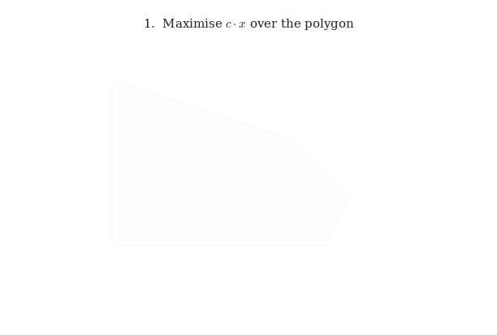
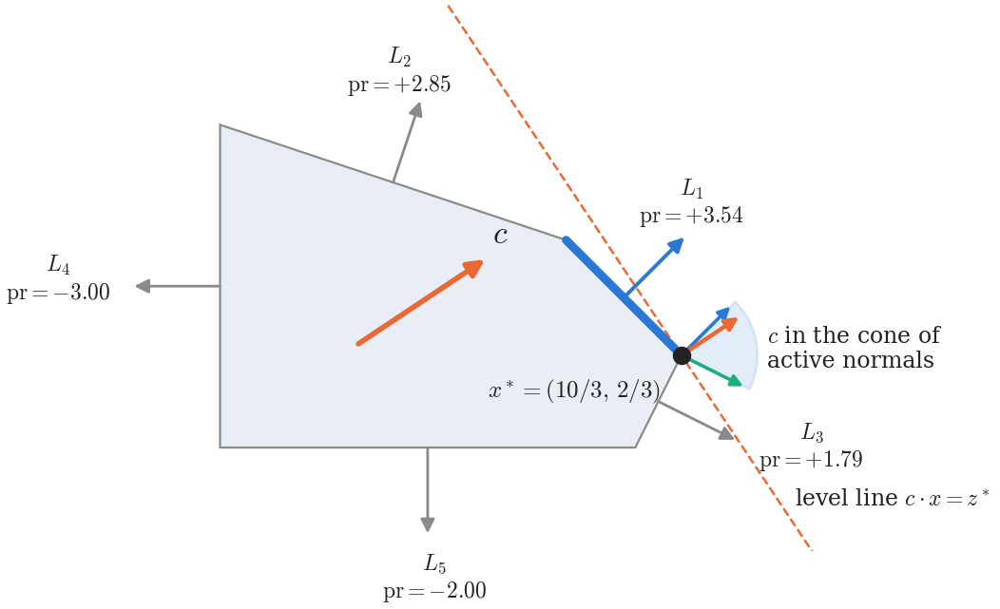
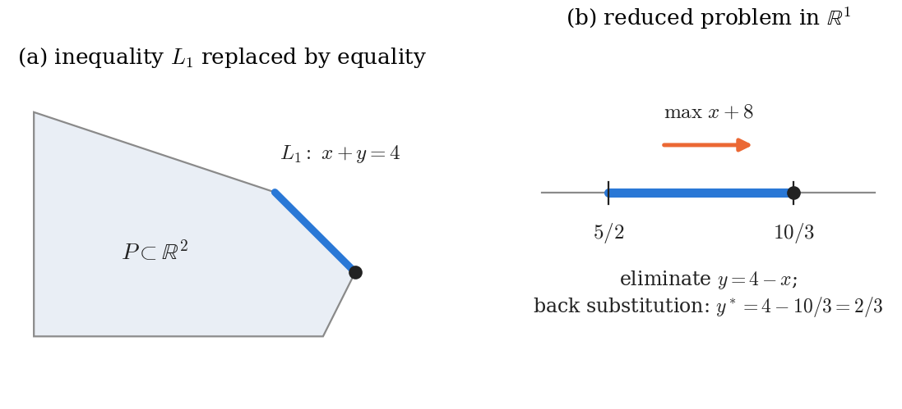
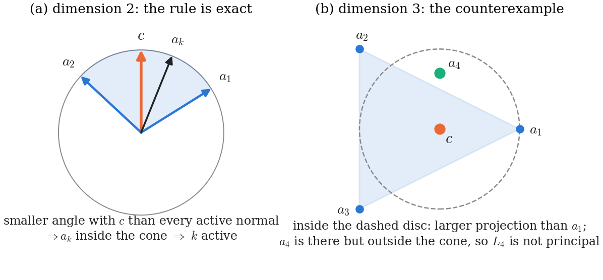

# Principal Hyperface Method
[](lean/)
[](python/)
[](LICENSE)
[](paper/main.pdf)

**Linear programming by looking at the picture. The objective vector points at the face that holds the optimum.
This is the Potapov–Grishin method (2007), completed, certified and machine-checked in Lean 4.**

> *"Find the face the objective points at, turn it into an equality, and the problem loses one dimension."*



---

## Why this matters

* **A simple geometric idea, now proved.** The method picks the face whose normal is closest in direction to the objective, turns it into an equality, and eliminates one variable, so each step lowers the dimension by one. It was published as a heuristic. This repository proves exactly when it is right: **a run is correct if and only if every chosen face is principal**. It also proves that **a principal face always exists**.
* **Exact where it can be.** In the plane the projection rule **never errs**. In three dimensions it can, and a machine-checked counterexample shows how.
* **Always correct.** The *certified* method follows the same rule, checks a dual certificate after every step, and backtracks when the check fails. It always finds an optimum when one exists, and each answer comes with a certificate you can check by hand.
* **Machine-checked to the bottom.** About 1,600 lines of Lean 4 and Mathlib, with no `sorry` and only the three standard axioms. Even Farkas' lemma is proved from scratch, over any ordered field.
* **Exact arithmetic.** The Python package uses fractions and makes the same choices as the verified Lean solver, so there is no rounding.

---

## How it works, in pictures

**1. The objective points at the right face.** Each face carries its outward normal and the projection of $c$ onto it. The largest projection belongs to $L_1$, and the optimum lies on $L_1$. At the optimum, $c$ sits inside the cone of the active normals. Those cone coefficients form the certificate.



**2. One step drops one dimension.** The chosen inequality becomes an equality, one variable is eliminated, and the rest is a smaller problem of the same kind. Back substitution returns the answer.



**3. Exact in 2-D, not in 3-D.** In the plane, a normal that beats every active normal on angle must lie inside their cone, so its face is active. In space it can lie outside the cone. That is why the certified method checks a certificate and backtracks when needed.



---

## What is proved

| Result | Lean theorem |
|:--|:--|
| A run returns an optimum **iff** every chosen face is principal | `Run.isOptimal_iff` |
| A wrong face can never be repaired later in the same run | `Problem.not_isOptimal_lift` |
| Farkas' lemma over any ordered field (Fourier–Motzkin) | `farkas` |
| Optimum ⇔ a dual certificate exists | `Problem.isOptimal_iff_exists_certificate` |
| **A principal face always exists** when $c \ne 0$ | `Problem.exists_isPrincipal` |
| **In 2-D the projection rule never errs** (no redundant constraints) | `Problem.active_of_isMaxProjection` |
| In 3-D it can err: explicit counterexample | `ProjectionCounterexample.method_fails` |
| **The certified method always finds an optimum** | `Problem.solve_isOptimal` |
| Grishin's 2008 worked example is exactly optimal, $z^\ast = 1008/5$ | `Grishin2008.xStar_isOptimal` |

---

## Quick start

### Use the method (Python)

```bash
pip install ./python
```

```python
from principal_hyperfaces import LinearProgram, solve

lp = LinearProgram.create(
    c=[3, 2],                                       # maximise 3x + 2y
    A=[[1, 1], [1, 3], [2, -1], [-1, 0], [0, -1]],  # subject to A·x <= b
    b=[4, 7, 6, 0, 0],
)
sol = solve(lp)

sol.x          # (10/3, 2/3), exact
sol.value      # 34/3
sol.certified  # True
sol.dual       # (7/3, 0, 1/3, 0, 0): the certificate, c = 7/3·a1 + 1/3·a3
```

### Check every proof (Lean 4)

```bash
cd lean
lake exe cache get   # downloads prebuilt Mathlib (~5 GB, once)
lake build           # checks all proofs and the solver runs; about a minute
```

### Reproduce the tests, figures and paper

```bash
cd python && python3 -m pytest -q && cd ..   # 64 tests, under a second
python3 paper/figures/make_figures.py        # Creates: paper/figures/fig1..fig4 (.pdf, .png)
python3 paper/figures/make_animation.py      # Creates: paper/figures/method.gif
cd paper && pdflatex main.tex && pdflatex main.tex   # Creates: paper/main.pdf
```

---

## Limits

In the worst case the certified method explores exponentially many branches, so it is not a polynomial-time algorithm. Polynomial algorithms for linear programming are classical (Khachiyan 1979, Karmarkar 1984). What this method offers is a guaranteed correct answer and a checkable proof for every certified result, built on a picture you can draw by hand.

## The paper

[*The Potapov–Grishin Principal Hyperface Method, Completed and Machine-Checked*](paper/main.pdf) (10 pages). It has full statements, proof sketches and the mapping to Lean.

## 🙌 Like the project?

If you find this approach useful or insightful, please ⭐️ it on [GitHub](https://github.com/albond/principal-hyperfaces).

## License

Code and Lean sources: [MIT](LICENSE). Paper: [CC BY 4.0](https://creativecommons.org/licenses/by/4.0/).
